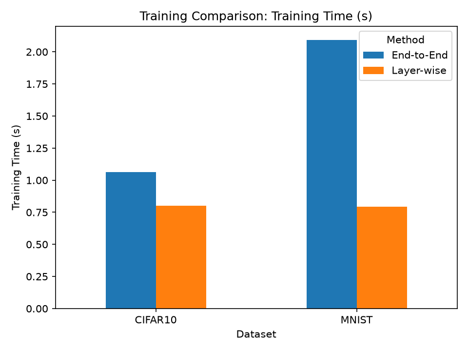

# Comparing End-to-End and Layer-wise Training in Deep Neural Networks

This project is a portfolio implementation comparing end-to-end and staged layer-wise training using convolutional neural networks in PyTorch.

## Technologies
- Python
- PyTorch and Torchvision
- Pandas and Matplotlib
- Apple Silicon MPS
- Pytest and GitHub Actions

## Methodology
- MNIST and CIFAR-10 image classification
- Convolutional neural networks
- End-to-end backpropagation
- Staged layer-wise parameter freezing
- Adam optimization
- Performance and training time comparison

## Experimental Configuration
- 5,000 training images per dataset
- 10,000 test images per dataset
- Four epochs per training method
- Batch size: 128
- Learning rate: 0.001
- Images resized to 32x32
- Random seed: 42

## Results

| Dataset | Method | Test Accuracy |
|---|---|---:|
| MNIST | End-to-End | 85.44% |
| MNIST | Layer-wise | 81.98% |
| CIFAR-10 | End-to-End | 36.97% |
| CIFAR-10 | Layer-wise | 34.72% |

End-to-end training achieved higher classification accuracy, while staged layer-wise training required less measured training time in this run.

## Performance Visualizations

### Accuracy

### Training Loss

### Training Time

[Detailed evaluation metrics](outputs/metrics.csv)

## Installation

    pip install -r requirements.txt

Download MNIST and CIFAR-10:

    python -c "from torchvision import datasets; [(d('data', train=t, download=True)) for d in [datasets.MNIST, datasets.CIFAR10] for t in [True, False]]"

Run training:

    python src/train.py

Run tests:

    python -m pytest

## Limitations
This is a reduced-scale educational experiment using a subset of training data and a single seed. Layer-wise training uses staged parameter freezing rather than independent greedy layer training. Results are not intended as state-of-the-art benchmarks.
