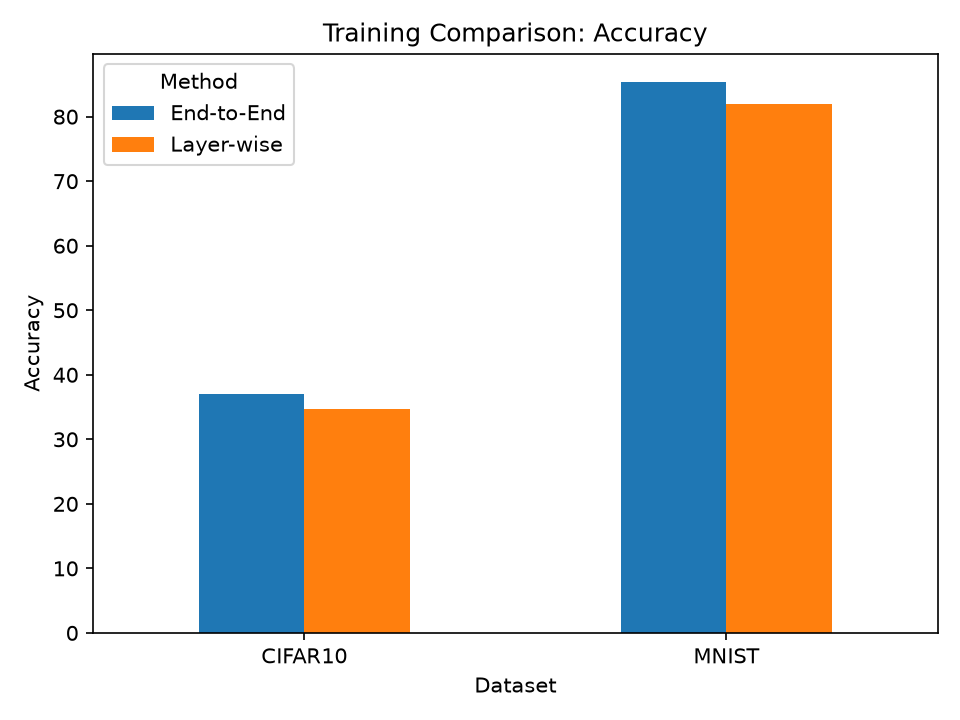
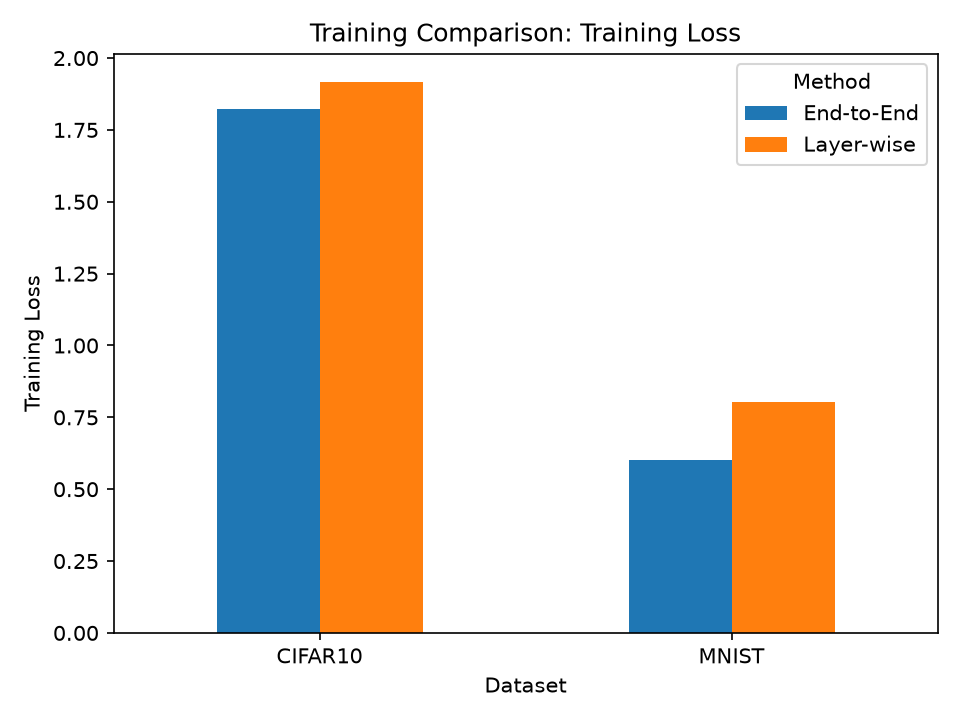

# Comparing End-to-End and Layer-wise Training in Deep Neural Networks

## Project Overview

This project compares end-to-end and layer-wise training approaches in deep neural networks using PyTorch. The objective is to evaluate how different training strategies affect classification accuracy, training loss, and computational efficiency.

## Datasets

- MNIST: 60,000 training images and 10,000 testing images available.
- CIFAR-10: 50,000 training images and 10,000 testing images available.

Both datasets are downloaded automatically using Torchvision.

## Methodology

### End-to-End Training
All network layers are trained simultaneously through backpropagation, allowing the entire network to optimize its parameters jointly.

### Layer-wise Training
A staged training approach is implemented using parameter freezing and progressive layer training.

## Technologies Used

- Python
- PyTorch
- Torchvision
- NumPy
- Pandas
- Matplotlib
- Apple GPU (MPS)
- Pytest
- Git and GitHub
- GitHub Actions (CI/CD)

## Experimental Results

The following results were obtained from a preliminary four-epoch experiment.

| Dataset | Training Method | Accuracy | Training Loss |
|---|---|---:|---:|
| MNIST | End-to-End | 85.44% | 0.6030 |
| MNIST | Layer-wise | 81.98% | 0.8048 |
| CIFAR-10 | End-to-End | 36.97% | 1.8243 |
| CIFAR-10 | Layer-wise | 34.72% | 1.9182 |

## Performance Visualizations

### Accuracy Comparison



### Training Loss Comparison



### Training Time Comparison


[View detailed experimental metrics](outputs/metrics.csv)

## Key Findings

- End-to-end training achieved higher classification accuracy on both datasets.
- Layer-wise training recorded shorter training times in this experiment.
- MNIST achieved higher classification accuracy than CIFAR-10.
- The results demonstrate a trade-off between predictive performance and computational efficiency.

## Installation and Execution

Install the required dependencies:

```bash
pip install -r requirements.txt
```

Run the training experiment:

```bash
python src/train.py
```

Run automated tests:

```bash
python -m pytest tests/ -v
```

## Automated Testing

GitHub Actions is configured to automatically execute model tests and validate the implementation. Both local tests and the GitHub Actions workflow passed successfully.

## Limitations and Future Improvements

- The experiment uses a limited number of training epochs.
- The layer-wise approach is a simplified staged training implementation.
- Additional experiments with larger training budgets, deeper architectures, and multiple random seeds could improve the reliability of the comparison.

## Conclusion

This project demonstrates the implementation and evaluation of different neural network training strategies using PyTorch. It explores the relationship between classification performance, training efficiency, and parameter optimization through comparative experimentation.
